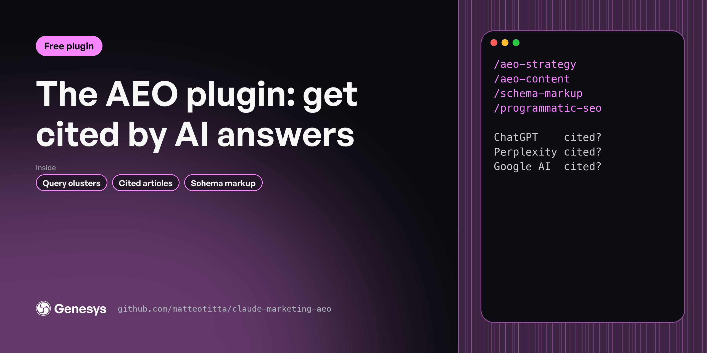

# AEO plugin

Buyers now ask ChatGPT, Perplexity and Google AI which tool to use. These 4 skills find the questions your buyers ask, check who gets cited today, and write the pages and schema that get you cited instead. For content and SEO leads at B2B SaaS companies.

**Free, MIT licensed. Works in Claude Code, Claude.ai and Cowork.**

---

## Install

In Claude Code:

```
/plugin marketplace add matteotitta/claude-marketing-aeo
/plugin install marketing-aeo@claude-marketing-aeo
```

From your terminal:

```bash
claude plugin marketplace add matteotitta/claude-marketing-aeo
claude plugin install marketing-aeo@claude-marketing-aeo
```

In Claude.ai or Cowork: download [`claude-marketing-aeo.zip`](https://github.com/matteotitta/claude-marketing-aeo/releases/latest) and upload it under *Customize → Plugins → Upload plugin*.

---

## Skills

| Skill | What it does |
|---|---|
| `/aeo-content` | Writes B2B SaaS articles built to be cited by ChatGPT, Claude, Perplexity and Google AI Overviews. |
| `/aeo-strategy` | Builds a search and AI-visibility plan for a B2B SaaS company. |
| `/programmatic-seo` | Plans a set of search pages generated from structured data. |
| `/schema-markup` | Generates paste-ready JSON-LD schema markup for a page or a batch of pages. |

**Start here:** `/aeo-strategy → /aeo-content → /schema-markup`

---

## Works best with your context

Every skill reads your context files before it writes: `context/icp/`, `context/positioning/`, `context/messaging/`, `context/brand/` and the rest. If a file is missing, the skill asks you or tells you what it's working without.

The quickest way to set those folders up is a free workspace template:

- [repo-structure-in-house](https://github.com/matteotitta/repo-structure-in-house) for one company
- [repo-structure-agency](https://github.com/matteotitta/repo-structure-agency) for agencies and consultants (swap `context/` for `clients/<client>/context/`)

---

## What the full version adds

These are free, shortened versions of skills from [Marketing Engineering University](https://maven.com/matteo-tittarelli/marketing-engineering-university-genesys-growth). The course versions add the reference material, worked examples and output templates these leave out, plus agents and hooks that chain the skills and check their own work. Week 3 of Marketing Engineering University turns this into a monthly visibility check that runs on a schedule.

## More free plugins

- [Marketing context plugin](https://github.com/matteotitta/claude-marketing-context)
- [Product launch plugin](https://github.com/matteotitta/claude-marketing-launch)
- [Website plugin](https://github.com/matteotitta/claude-marketing-website)
- [LinkedIn plugin](https://github.com/matteotitta/claude-marketing-linkedin)
- [Content plugin](https://github.com/matteotitta/claude-marketing-content)
- [Build your own GTM skills](https://github.com/matteotitta/gtm-skill-template)

---

Built by [Matteo Tittarelli](https://www.linkedin.com/in/matteotittarelli/) at [Genesys Growth](https://genesysgrowth.com). MIT licensed.
